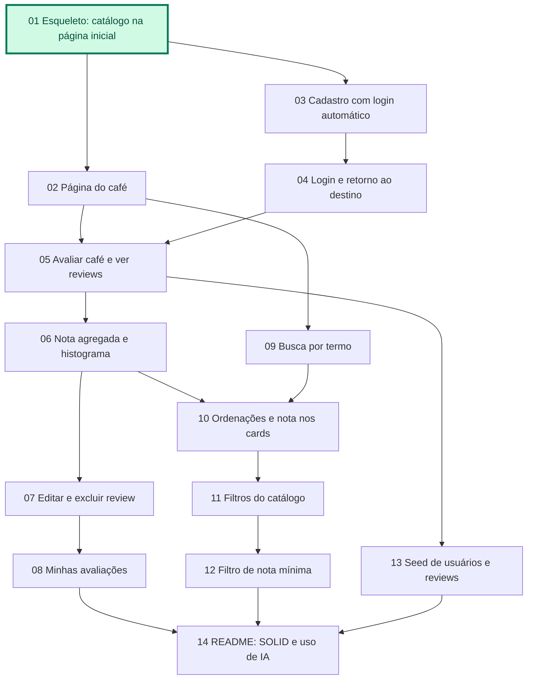

# DAG das issues: Cafeteca MVP (A2)

Uma aresta `A --> B` significa que A bloqueia B. Os nós em destaque estão
na fronteira (sem bloqueios em aberto) e podem começar já.

O grafo é acíclico: toda aresta vai de uma issue de número menor para uma
de número maior, e a ordenação topológica foi conferida com
`graphlib.TopologicalSorter` a partir do "Bloqueado por" de cada arquivo.

## Ondas de trabalho (enquanto a fronteira avança)

| Onda | Issues que podem rodar em paralelo |
| --- | --- |
| 1 | 01 |
| 2 | 02, 03 |
| 3 | 04, 09 |
| 4 | 05 |
| 5 | 06, 13 |
| 6 | 07, 10 |
| 7 | 08, 11 |
| 8 | 12 |
| 9 | 14 |
